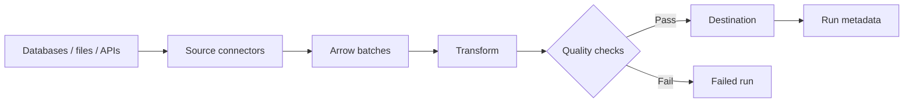

# DataBridge

**Connect. Transform. Deliver.**

DataBridge is an open-source project under development for reliable, cloud-agnostic data integration. It aims to connect databases, files, APIs and object storage through reusable, configuration-driven pipelines, with explicit data quality checks before delivery.

> **Status: early development.** The Python project scaffold and development environment have been initialized. The first executable pipeline is the next milestone. Features described here are design targets, not released functionality.

## Why DataBridge?

| Problem | Proposed solution |
| --- | --- |
| Repeated SQL and export scripts | Reusable YAML pipelines |
| Fragmented data sources | Standard connector interfaces |
| Duplicate, missing or conflicting records | Explicit validation and quality gates |
| Unreliable exports | Atomic local file publication |
| Hardcoded credentials | Environment-based secret references |
| Difficult troubleshooting | Structured logs and run metadata |

## How it works

[System architecture](architecture/system-design.md) · [Data processing](architecture/data-processing.md)

## Technology stack

| Layer | Technology |
| --- | --- |
| Language | Python 3.12, SQL |
| Data processing | Polars, Apache Arrow / PyArrow |
| Configuration | YAML, Pydantic |
| Connectivity | SQLAlchemy and native drivers |
| CLI | Typer |
| Local metadata | SQLite (planned) |
| Console | Streamlit (planned) |
| Development | uv, Ruff, mypy, pytest |
| Distribution | Python package, Docker (planned) |

## Documentation

### Project
- [Project definition](project/overview.md)
- [Problem statement](project/problem-and-use-cases.md)
- [Development roadmap](project/roadmap.md)
- [Risks and project boundaries](project/risks-and-scope.md)
- [Open-source governance](project/governance.md)
- [Final project specification](project/specification.md)

### Requirements
- [Software requirements specification — 95 functional requirements](requirements/srs.md)

### Architecture
- [System architecture](architecture/system-design.md)
- [Technology stack](architecture/technology-stack.md)
- [Connectivity architecture](architecture/connectors.md)
- [Data processing architecture](architecture/data-processing.md)
- [Configuration and execution](architecture/configuration-and-execution.md)
- [Metadata and storage](architecture/metadata.md)
- [Security architecture](architecture/security.md)
- [Monitoring and scheduling](architecture/monitoring-and-scheduling.md)
- [Graphical user interface](architecture/dashboard.md)
- [SVG diagram library](architecture/diagrams/)

### Development
- [Repository architecture](development/repository-structure.md)
- [Software development lifecycle](development/workflow-and-testing.md)
- [Deployment and distribution](development/deployment.md)
- [Initial implementation plan](development/implementation-plan.md)

### Complete reference
- [Full project master plan — 83 sections](architecture/master-plan.md)

## First milestone

SQLite → parameterized extraction → Arrow batches → schema validation → atomic CSV export. Acceptance requires passing tests, safe failure handling and documented execution.

## Project boundaries

This repository documents the independent, self-hosted open-source edition only. Apache-2.0 is the proposed license; final licensing and package-name availability remain to be verified. No proprietary datasets, credentials or employer-owned code belong here.
