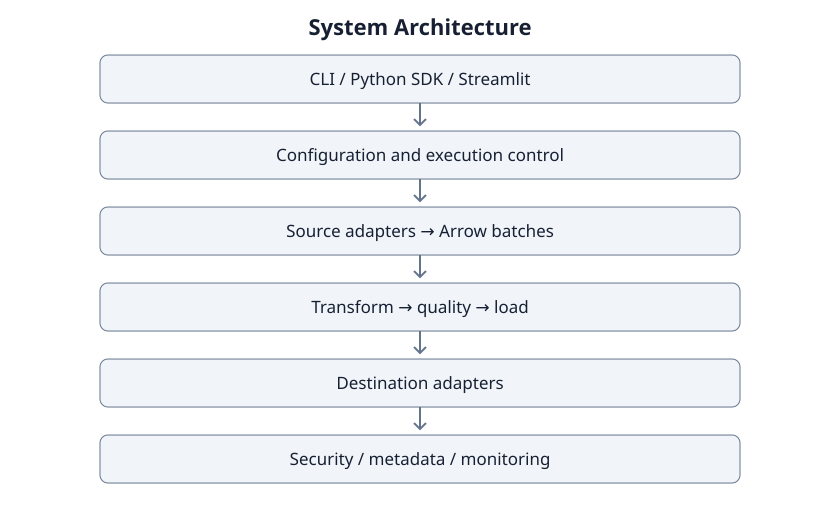

# DataBridge Documentation

**Connect. Transform. Deliver.**

DataBridge is a planned open-source, cloud-agnostic data integration and engineering platform built with Python.

## Start here

- [Project master plan](architecture/master-plan.md) — vision, SRS, architecture, technology stack, security, testing, governance and roadmap.
- [Architecture diagrams](architecture/diagrams/) — 19 lightweight SVG illustrations linked from the master plan.

## Project status

Initial development. The master plan describes proposed capabilities, not a claim that they have been implemented. This repository covers the independent open-source project only.

## Documentation maintenance

Update the master plan and relevant diagrams together when architectural decisions change. Keep secrets, proprietary data and credentials out of the repository.
