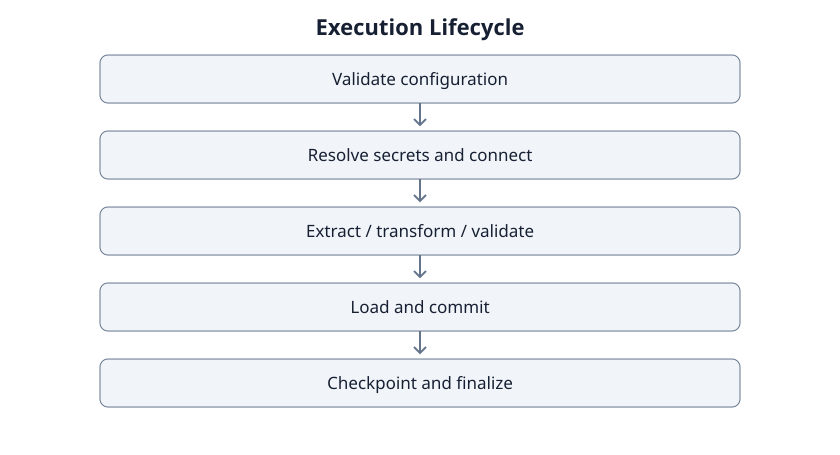
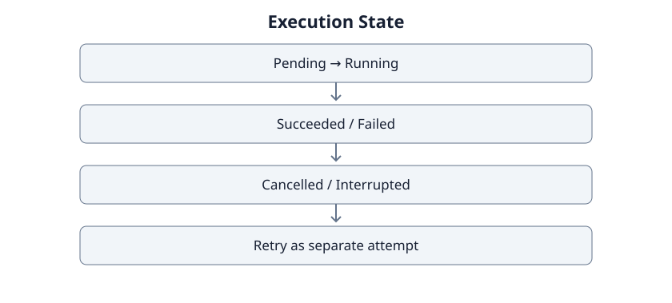

# Configuration and execution

[Documentation home](../README.md) · [Complete master plan](../architecture/master-plan.md)

> Design specification — proposed capabilities unless explicitly marked verified.

### 38. Configuration-driven architecture

Illustrative advanced schema; v0.1 will use a smaller schema.

```yaml
version: 1
pipeline:
  name: customer_orders
  description: Consolidate customer and order records
connections:
  sales_db:
    type: postgresql
    host: ${POSTGRES_HOST}
    port: 5432
    database: sales
    username: ${POSTGRES_USER}
    password: ${POSTGRES_PASSWORD}
    sslmode: verify-full
sources:
  customers:
    connection: sales_db
    query: |
      SELECT customer_id, customer_name, country FROM customers
  orders:
    connection: sales_db
    query: |
      SELECT order_id, customer_id, amount FROM orders
transformations:
  - type: join
    left: orders
    right: customers
    on: [customer_id]
    how: left
    cardinality: many_to_one
    output: customer_orders
  - type: trim
    dataset: customer_orders
    columns: [customer_name, country]
validation:
  dataset: customer_orders
  rules:
    - type: not_null
      columns: [order_id, customer_id]
    - type: unique
      columns: [order_id]
    - type: range
      column: amount
      min: 0
destination:
  type: parquet
  dataset: customer_orders
  path: output/customer_orders.parquet
  mode: overwrite
execution:
  batch_size: 50000
  on_validation_failure: fail
```

### 39. Pipeline lifecycle



### 40. Execution status



Retries are separate attempts; preserve failure history.

### 41. CLI commands

```bash
databridge --version
databridge --help
databridge init
databridge validate pipeline.yaml
databridge run pipeline.yaml
databridge run pipeline.yaml --dry-run
databridge connectors list
databridge connections test sales_db
databridge schema inspect sales_db
databridge runs list
databridge runs show RUN_ID
databridge logs RUN_ID
databridge schedules list
databridge dashboard
```

| Area | Specification |
| --- | --- |
| 0 | Success |
| 1 | General error |
| 2 | Invalid configuration or command |
| 3 | Connection failure |
| 4 | Extraction failure |
| 5 | Transformation failure |
| 6 | Validation failure |
| 7 | Destination failure |
| 130 | Interrupted |

### 42. Python SDK

```python
from databridge import Pipeline
pipeline = Pipeline.from_yaml("pipeline.yaml")
result = pipeline.run()
print(result.status)
print(result.rows_extracted)
print(result.rows_loaded)
print(result.duration_seconds)
```

Illustrative public API; keep it independent of internals.
