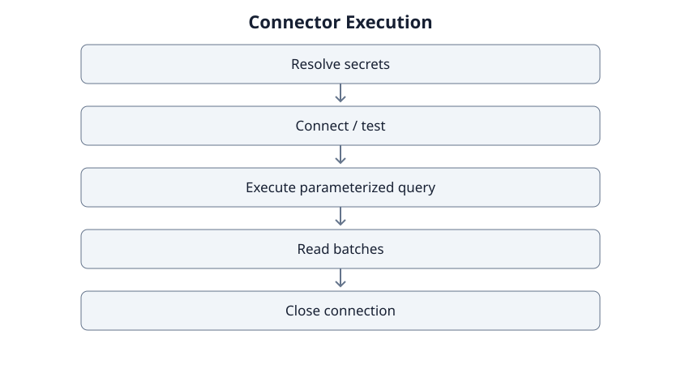

# Connectivity architecture

[Documentation home](../README.md) · [Complete master plan](../architecture/master-plan.md)

> Design specification — proposed capabilities unless explicitly marked verified.

### 24. Database roadmap

| Area | Specification |
| --- | --- |
| SQLite | sqlite3 / v0.1 |
| PostgreSQL | psycopg / v0.1 |
| MySQL | PyMySQL / v0.1 |
| ClickHouse | clickhouse-connect / v0.1 |
| MariaDB | PyMySQL or compatible / v0.5 |
| SQL Server | pyodbc / v0.5 |
| Oracle | oracledb / v0.5 |
| Snowflake | snowflake-connector-python / v0.5 |
| Redshift | redshift-connector / v0.5 |
| BigQuery | google-cloud-bigquery / v0.5 |
| Databricks | databricks-sql-connector / later |
| MongoDB | pymongo / later |
| Elasticsearch | elasticsearch / later |

Remote access depends on network, authentication, permissions and driver compatibility.

### 25. File formats

| Area | Specification |
| --- | --- |
| CSV / TSV | Polars or standard library; read/write planned |
| XLSX | OpenPyXL; tabular data only, no arbitrary workbook preservation guarantee |
| JSON / NDJSON | Polars or standard library |
| Parquet | PyArrow / Polars |
| Arrow IPC | PyArrow |
| Avro / XML | Future, compatible or secure parser |

### 26. Object storage

| Area | Specification |
| --- | --- |
| S3 / MinIO | boto3 |
| Azure Blob | azure-storage-blob |
| ADLS Gen2 | azure-storage-file-datalake |

| Area | Specification |
| --- | --- |
| GCS | google-cloud-storage |

### 27. Connector contract

Explicit capabilities, resource ownership, types, errors and batch semantics. File connectors need not implement SQL.

```python
class SourceConnector:
    def connect(self): ...
    def test_connection(self): ...
    def discover_schema(self): ...
    def read_batches(self, request): ...
    def close(self): ...
```

### 28. Connector execution



### 29. Plugin system

Python package entry points for sources, destinations, transformations and quality rules. Plugins execute trusted Python code and are not sandboxed.

```toml
[project.entry-points."databridge.sources"]
custom_database = "custom_connector:CustomConnector"
```
