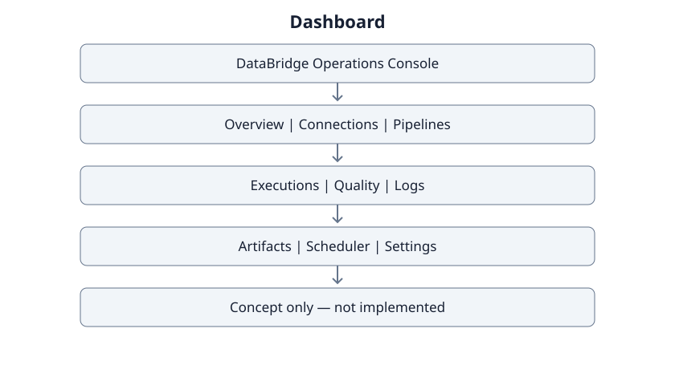

# Graphical user interface

[Documentation home](../README.md) · [Complete master plan](../architecture/master-plan.md)

> Design specification — proposed capabilities unless explicitly marked verified.

### 54. Dashboard technology

Native Streamlit components; no custom HTML, CSS, JavaScript, React or Node.js.

### 55. Dashboard modules

| Area | Specification |
| --- | --- |
| Overview | Pipeline and execution statistics |
| Connections | Configure and test |
| Data Explorer | Schemas and previews |
| SQL Workspace | Authorized queries |
| Pipelines | Create and manage |
| Executions | Start and monitor |
| Scheduler | Manage schedules |
| Data Quality | Validation reports |
| Logs | Sanitized logs |
| Artifacts | Generated outputs |
| Settings | Local settings |
| About | Version, license, docs |

### 56. Dashboard wireframe

Concept only; illustrative metrics, neutral black and white theme, not an implemented application.
