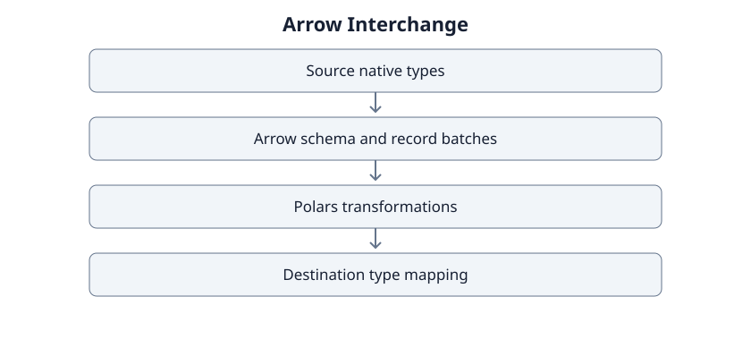
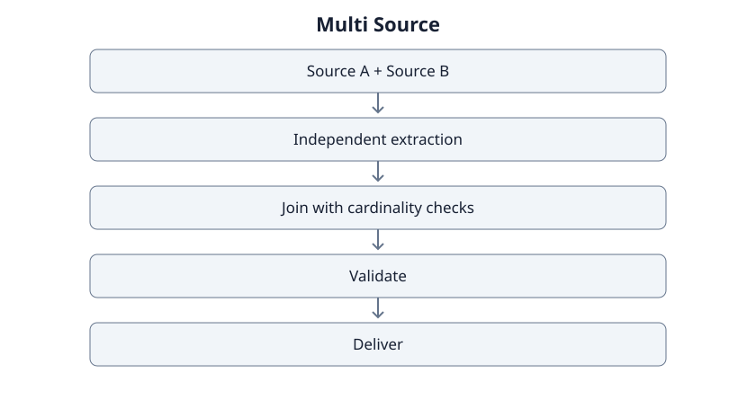
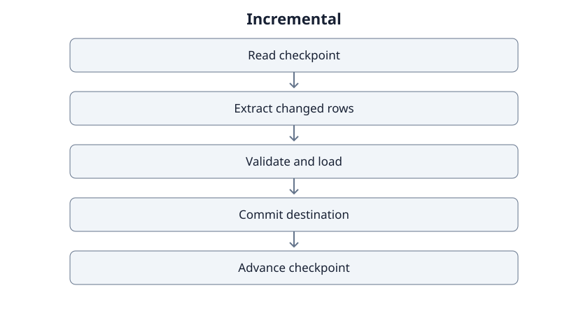

# Data processing architecture

[Documentation home](../README.md) · [Complete master plan](../architecture/master-plan.md)

> Design specification — proposed capabilities unless explicitly marked verified.

### 30. Processing models

Initial full and batch extraction; core ETL and multi-source integration; advanced incremental, ELT and scheduled batches; CDC future research; real-time streaming outside v1.0.

### 31. ETL

### 32. ELT

ELT requires destination SQL and staging capabilities.

### 33. Internal representation

Preserve decimal precision, timestamps, time zones, nullability and identifiers. Explicitly handle unsupported or lossy mappings.

### 34. Transformation catalog

Select/drop/rename/reorder; trim/normalize/replace; filters; cast/parse/format; fill/reject/flag nulls; inner/left/right/full joins; count/sum/average/min/max; grouping; explicit deduplication; expressions; pivot/unpivot; sorting; dates; local or destination SQL; registered Python transforms.

### 35. Multi-source pipelines

### 36. Large datasets

Configurable record batches, lazy operations, streaming where supported, database pushdown and temporary disk processing. Global sorts, joins and exact uniqueness may need additional memory or disk. Proposed default 50,000 rows per batch. For 10 million rows at 200 bytes each: 2 GB raw, 200 batches, 10 MB raw per batch, 0.5% of dataset. Actual RAM may be higher.

### 37. Incremental extraction

Watermarks, numeric IDs or composite cursors. Handle equal timestamps and late arrivals; retries may duplicate writes; watermarks do not detect deletes.

