# DataBridge — Open-Source Project Master Plan

**Document v1.0 · Initial software v0.1.0 · Target v1.0.0 · 25 November 2026**

*Connect. Transform. Deliver.*

Independent, self-hosted open-source edition only. All proposed capabilities remain subject to implementation and verification.

## Contents

- [01 Project definition](#part-01)

- [02 Problem statement](#part-02)

- [03 Software requirements specification](#part-03)

- [04 System architecture](#part-04)

- [05 Technology stack](#part-05)

- [06 Connectivity architecture](#part-06)

- [07 Data processing architecture](#part-07)

- [08 Configuration and execution](#part-08)

- [09 Metadata and storage](#part-09)

- [10 Security architecture](#part-10)

- [11 Monitoring and scheduling](#part-11)

- [12 Graphical user interface](#part-12)

- [13 Repository architecture](#part-13)

- [14 Software development lifecycle](#part-14)

- [15 Deployment and distribution](#part-15)

- [16 Open-source governance](#part-16)

- [17 Development roadmap](#part-17)

- [18 Initial implementation plan](#part-18)

- [19 Risks and project boundaries](#part-19)

- [20 Final project specification](#part-20)

<a id="part-01"></a>

## Part 01 — Project definition

### 1. Project overview

DataBridge is an open-source, cloud-agnostic data integration and engineering platform for connecting, extracting, transforming, validating and delivering data across databases, APIs, files and storage. It provides reusable configuration-driven pipelines, a Python package, CLI, SDK and self-hosted console.

### 2. Vision

Make reliable data integration accessible without expensive infrastructure, proprietary software or unnecessary distributed systems.

### 3. Mission

Bridge raw sources and validated, business-ready datasets through a lightweight, extensible and secure platform.

### 4. Objectives

Standardized heterogeneous connectivity; reusable ETL and selected ELT; multi-system integration; quality and integrity; reduced manual work; reproducibility and auditability; Windows, Linux and macOS; community plugins; vendor independence.

### 5. Identity

Free and open source; local and self-hosted; batch-first; declarative YAML; modular plugin-oriented architecture; for engineers and analysts. Proposed Apache 2.0 license. Fedora, Zsh, VS Code and GitHub development environment.

<a id="part-02"></a>

## Part 02 — Problem statement

### 6. Problems and solutions

Fragmented systems lead to repeated scripts, manual joins, copy-paste, inconsistent validation, data errors, lost time and maintenance overhead.

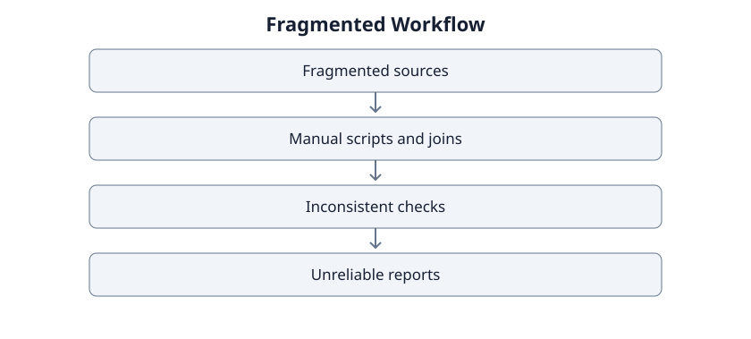

| Area | Specification |
| --- | --- |
| Scattered data | Unified connectors |
| Repeated scripts | Reusable pipelines |
| Manual files | Automated ingestion and export |
| Different protocols | Standard interfaces |
| Duplicates and conflicts | Explicit quality rules |
| Missing data | Schema and completeness validation |
| Cross-database joins | Transformation engine |
| Hardcoded credentials | Secret resolution |
| Untraceable failures | Logs and history |
| Full extraction | Incremental checkpoints |
| Memory limits | Batch processing |
| Vendor lock-in | Portable open formats |
| Complex deployment | Local and containerized deployment |
| Central management | Self-hosted console |
| Maintenance | Modular tested documentation |

### 7. Use cases

MySQL to PostgreSQL migration; ClickHouse to Parquet; Excel + PostgreSQL enrichment; REST API to PostgreSQL; multi-source consolidation; scheduled SQL-to-CSV reporting; quality audits; warehouse ingestion to Snowflake; Parquet to S3; reconciliation; incremental PostgreSQL to ClickHouse; clean analytical datasets. Large transfers depend on connector and batching semantics.

### 8. Target users

Data engineers, analysts, MIS professionals, developers, BI developers, DBAs, researchers, small teams and open-source contributors.

### 9. Positioning

Airflow orchestrates; Airbyte replicates and integrates; dbt transforms in SQL; Spark distributes processing; Kafka streams events; DuckDB, Polars and Pandas are complementary or internal engines. DataBridge aims to combine lightweight integration, quality enforcement and business-ready delivery, not claim competitors lack these features.

<a id="part-03"></a>

## Part 03 — Software requirements specification

### 10. Purpose and scope

Define, execute, monitor and manage pipelines through code, configuration and a graphical console. P0 essential; P1 core; P2 advanced; P3 future.

### 11. Functional requirements

#### 11.1 Source connectivity

| ID | Requirement | Priority |
| --- | --- | --- |
| FR-001 | Connect relational databases | P0 |
| FR-002 | Connect analytical databases | P0 |
| FR-003 | Test connections | P0 |
| FR-004 | Secure credentials | P0 |
| FR-005 | Parameterized SQL | P0 |
| FR-006 | Configurable batches | P0 |
| FR-007 | Discover schemas and tables | P1 |
| FR-008 | Discover column types | P1 |
| FR-009 | Read CSV Excel JSON Parquet | P1 |
| FR-010 | REST APIs | P2 |
| FR-011 | Object storage | P2 |
| FR-012 | Connection timeouts | P0 |
| FR-013 | TLS | P0 |
| FR-014 | External plugins | P2 |

#### 11.2 Pipeline management

| ID | Requirement | Priority |
| --- | --- | --- |
| FR-015 | YAML pipelines | P0 |
| FR-016 | Validate configuration | P0 |
| FR-017 | CLI execution | P0 |
| FR-018 | Python SDK | P1 |
| FR-019 | Named connections | P1 |
| FR-020 | Multiple input datasets | P1 |
| FR-021 | Execution parameters | P1 |
| FR-022 | Dependencies | P2 |
| FR-023 | Scheduling | P2 |

| ID | Requirement | Priority |
| --- | --- | --- |
| FR-024 | Retries | P2 |
| FR-025 | Cancellation | P2 |
| FR-026 | Incremental extraction | P2 |
| FR-027 | Checkpoint recovery | P2 |
| FR-028 | Dry-run validation | P1 |

#### 11.3 Transformations

| ID | Requirement | Priority |
| --- | --- | --- |
| FR-029 | Select/remove columns | P1 |
| FR-030 | Rename | P1 |
| FR-031 | Filter | P1 |
| FR-032 | Cast | P1 |
| FR-033 | Normalize strings | P1 |
| FR-034 | Missing values | P1 |
| FR-035 | Sort | P1 |
| FR-036 | Join | P1 |
| FR-037 | Aggregate/group | P1 |
| FR-038 | Calculated columns | P1 |
| FR-039 | Explicit deduplication | P1 |
| FR-040 | Local SQL | P2 |
| FR-041 | Custom Python | P2 |
| FR-042 | Conditional transformations | P2 |
| FR-043 | Schema mapping | P2 |
| FR-044 | Nested data | P2 |

#### 11.4 Quality

| ID | Requirement | Priority |
| --- | --- | --- |
| FR-045 | Required columns | P0 |
| FR-046 | Expected schemas | P1 |
| FR-047 | Uniqueness | P1 |
| FR-048 | Non-null | P1 |
| FR-049 | Data types | P1 |

| ID | Requirement | Priority |
| --- | --- | --- |
| FR-050 | Allowed values | P1 |
| FR-051 | Ranges | P1 |
| FR-052 | Row counts | P1 |
| FR-053 | Detect duplicates | P1 |
| FR-054 | Detect conflicts | P1 |
| FR-055 | Join cardinality | P1 |
| FR-056 | Quality reports | P1 |
| FR-057 | Warn/fail policies | P1 |
| FR-058 | Quarantine | P2 |
| FR-059 | Schema drift | P2 |
| FR-060 | Thresholds | P2 |

#### 11.5 Destinations

| ID | Requirement | Priority |
| --- | --- | --- |
| FR-061 | CSV | P0 |
| FR-062 | Excel | P0 |
| FR-063 | Parquet | P1 |
| FR-064 | JSON/NDJSON | P1 |
| FR-065 | Database writes | P1 |
| FR-066 | Object storage | P2 |
| FR-067 | Append/overwrite | P1 |
| FR-068 | Upsert | P2 |
| FR-069 | Atomic local publication | P0 |
| FR-070 | Compression | P2 |
| FR-071 | Partitioned datasets | P2 |
| FR-072 | Spreadsheet formula injection prevention | P0 |

#### 11.6 Observability

| ID | Requirement | Priority |
| --- | --- | --- |
| FR-073 | Unique run IDs | P0 |
| FR-074 | Start/end times | P0 |

| ID | Requirement | Priority |
| --- | --- | --- |
| FR-075 | Status | P0 |
| FR-076 | Sanitized structured logs | P0 |
| FR-077 | Extracted/loaded counts | P0 |
| FR-078 | History | P1 |
| FR-079 | Validation results | P1 |
| FR-080 | Stage metrics | P1 |
| FR-081 | Dataset lineage | P2 |
| FR-082 | Export metrics | P2 |
| FR-083 | Log retention | P2 |

#### 11.7 Graphical interface

| ID | Requirement | Priority |
| --- | --- | --- |
| FR-084 | Overview | P2 |
| FR-085 | Connection definitions | P2 |
| FR-086 | Schema browsing | P2 |
| FR-087 | Controlled SQL workspace | P2 |
| FR-088 | Pipeline editing | P2 |
| FR-089 | Execute pipelines | P2 |
| FR-090 | History | P2 |
| FR-091 | Logs | P2 |
| FR-092 | Quality reports | P2 |
| FR-093 | Authorized outputs | P2 |
| FR-094 | Schedules | P2 |
| FR-095 | Settings | P2 |

Conflicting records must never be silently discarded; explicit policies are required.

### 12. Non-functional requirements

| ID | Requirement |
| --- | --- |
| NFR-001 | Windows/Linux/macOS portability |
| NFR-002 | Minimize copying |
| NFR-003 | Configurable batches |
| NFR-004 | Avoid mandatory full loading |

| ID | Requirement |
| --- | --- |
| NFR-005 | No credentials in logs |
| NFR-006 | Encrypted connections |
| NFR-007 | Least privilege |
| NFR-008 | Fail on critical validation |
| NFR-009 | No incomplete local output |
| NFR-010 | Separated responsibilities |
| NFR-011 | Independent connectors |
| NFR-012 | Unit/integration/E2E tests |
| NFR-013 | Actionable errors |
| NFR-014 | Versioned configs |
| NFR-015 | Execution traceability |
| NFR-016 | Supported version matrix |
| NFR-017 | Public interface documentation |
| NFR-018 | Minimal sensitive retention |
| NFR-019 | No mandatory hosted service |
| NFR-020 | Usable CLI and console |

### 13. Performance targets

Proposed, not measured: lightweight CLI startup under 2 seconds; 1 million representative records; bounded-memory demonstration with 10 million; configurable batches; 85% core coverage before v1.0; no silent record loss or plaintext credentials in logs; terminal status for completed/reconciled runs. Record hardware, row width, types, network, versions and complexity in benchmarks.

<a id="part-04"></a>

## Part 04 — System architecture

### 14. Architecture

Modular monolith with plugin-oriented interfaces and layered responsibilities. Single Python package initially, avoiding microservices complexity.

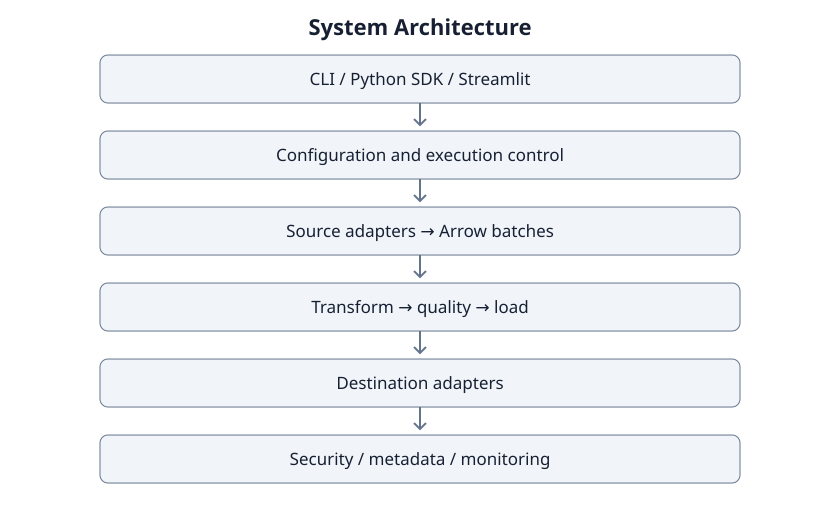

### 15. Patterns

Adapter for connectivity; strategy for transformations and rules; registry for discovery; factory for initialization; repository for metadata; dependency injection; pipeline; context managers; future producer-consumer batching. Use only when practical.

### 16. Control and data planes

Control: configurations, connections, schedules, history, settings and metadata. Data: connectivity, extraction, transformations, validation, loading and batches. Engine runs independently of UI or scheduler.

### 17. Components

Configuration manager parses and validates; connection manager initializes settings; registries resolve adapters; pipeline manager coordinates stages; execution manager tracks lifecycle; extraction, transformation, quality and loading engines process data; scheduler triggers runs; checkpoints track state; metadata repository persists operations; secrets resolve credentials; monitoring records events; dashboard, CLI and SDK expose interfaces.

### 18. Dependency rules

Core must not import Typer or Streamlit. Interfaces separate engine from native drivers and processing implementations.

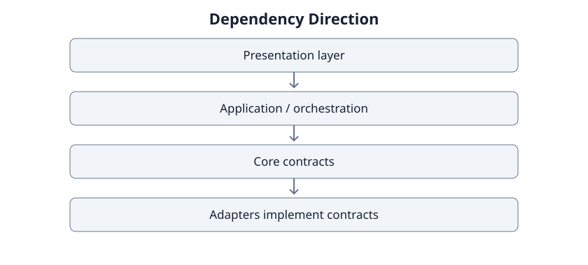

<a id="part-05"></a>

## Part 05 — Technology stack

### 19. Languages

Python 3.12 primary; SQL queries and transforms; YAML, TOML and JSON configuration/data; shell automation. No custom Rust, C++, Go, Java or JavaScript initially.

### 20. Frameworks

Pydantic typed validation; Typer CLI; Streamlit native console; SQLAlchemy relational abstraction.

### 21. Processing technologies

Polars primary transformations and lazy/streaming operations; PyArrow columnar interchange and Parquet; DuckDB embedded SQL analytics; Pandas optional compatibility.

### 22. Native engines

Python orchestrates optimized native libraries; actual performance depends on workload and memory.

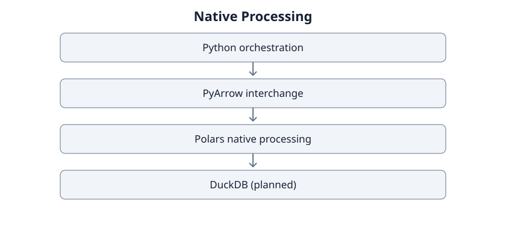

### 23. Technology inventory

| Area | Specification |
| --- | --- |
| Configuration | YAML, Pydantic, PyYAML |
| Interfaces | Typer, Streamlit |
| Processing | Polars, PyArrow, DuckDB, optional Pandas |
| Database | SQLAlchemy, SQLite metadata |
| Files / HTTP | OpenPyXL, HTTPX |
| Secrets | python-dotenv, optional OS keyring |
| Scheduling / retries | APScheduler, Tenacity (proposed) |
| Standard library | logging, importlib.metadata, pathlib, uuid |
| Packaging | uv, uv_build, uv.lock |
| Testing | Pytest, pytest-cov, Testcontainers |
| Quality | Ruff, mypy, pre-commit |

| Area | Specification |
| --- | --- |
| Documentation | MkDocs Material |
| Version control / CI | Git, GitHub, GitHub Actions |
| Deployment | Docker, Compose, PyPI, GHCR |
| Security | Dependabot, CodeQL, pip-audit |
| License | Apache 2.0 proposed |

<a id="part-06"></a>

## Part 06 — Connectivity architecture

### 24. Database roadmap

| Area | Specification |
| --- | --- |
| SQLite | sqlite3 / v0.1 |
| PostgreSQL | psycopg / v0.1 |
| MySQL | PyMySQL / v0.1 |
| ClickHouse | clickhouse-connect / v0.1 |
| MariaDB | PyMySQL or compatible / v0.5 |
| SQL Server | pyodbc / v0.5 |
| Oracle | oracledb / v0.5 |
| Snowflake | snowflake-connector-python / v0.5 |
| Redshift | redshift-connector / v0.5 |
| BigQuery | google-cloud-bigquery / v0.5 |
| Databricks | databricks-sql-connector / later |
| MongoDB | pymongo / later |
| Elasticsearch | elasticsearch / later |

Remote access depends on network, authentication, permissions and driver compatibility.

### 25. File formats

| Area | Specification |
| --- | --- |
| CSV / TSV | Polars or standard library; read/write planned |
| XLSX | OpenPyXL; tabular data only, no arbitrary workbook preservation guarantee |
| JSON / NDJSON | Polars or standard library |
| Parquet | PyArrow / Polars |
| Arrow IPC | PyArrow |
| Avro / XML | Future, compatible or secure parser |

### 26. Object storage

| Area | Specification |
| --- | --- |
| S3 / MinIO | boto3 |
| Azure Blob | azure-storage-blob |
| ADLS Gen2 | azure-storage-file-datalake |

| Area | Specification |
| --- | --- |
| GCS | google-cloud-storage |

### 27. Connector contract

Explicit capabilities, resource ownership, types, errors and batch semantics. File connectors need not implement SQL.

```python
class SourceConnector:
    def connect(self): ...
    def test_connection(self): ...
    def discover_schema(self): ...
    def read_batches(self, request): ...
    def close(self): ...
```

### 28. Connector execution

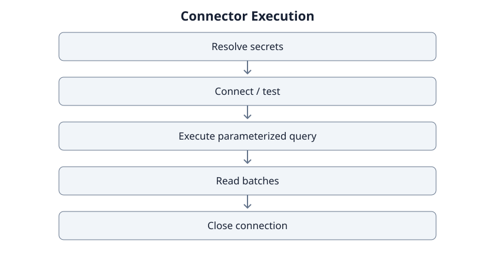

### 29. Plugin system

Python package entry points for sources, destinations, transformations and quality rules. Plugins execute trusted Python code and are not sandboxed.

```toml
[project.entry-points."databridge.sources"]
custom_database = "custom_connector:CustomConnector"
```

<a id="part-07"></a>

## Part 07 — Data processing architecture

### 30. Processing models

Initial full and batch extraction; core ETL and multi-source integration; advanced incremental, ELT and scheduled batches; CDC future research; real-time streaming outside v1.0.

### 31. ETL


### 32. ELT

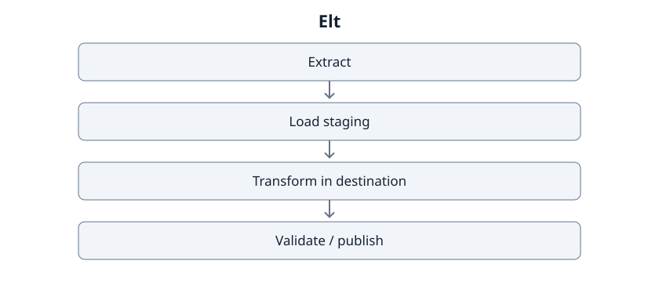

ELT requires destination SQL and staging capabilities.

### 33. Internal representation

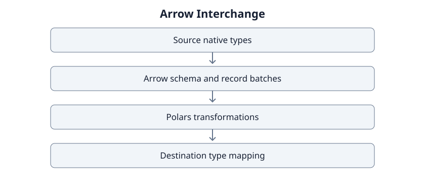

Preserve decimal precision, timestamps, time zones, nullability and identifiers. Explicitly handle unsupported or lossy mappings.

### 34. Transformation catalog

Select/drop/rename/reorder; trim/normalize/replace; filters; cast/parse/format; fill/reject/flag nulls; inner/left/right/full joins; count/sum/average/min/max; grouping; explicit deduplication; expressions; pivot/unpivot; sorting; dates; local or destination SQL; registered Python transforms.

### 35. Multi-source pipelines

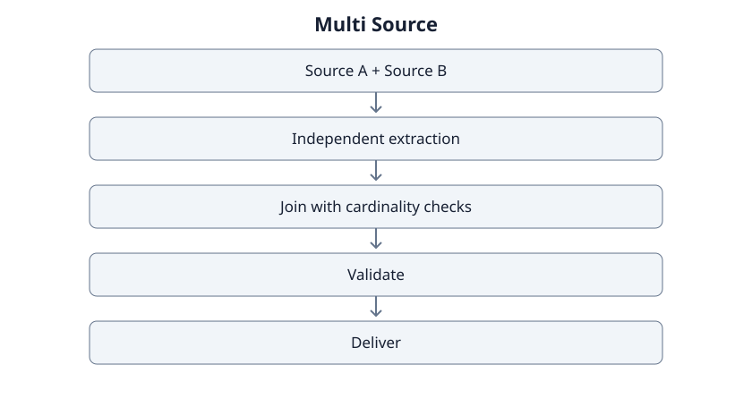

### 36. Large datasets

Configurable record batches, lazy operations, streaming where supported, database pushdown and temporary disk processing. Global sorts, joins and exact uniqueness may need additional memory or disk. Proposed default 50,000 rows per batch. For 10 million rows at 200 bytes each: 2 GB raw, 200 batches, 10 MB raw per batch, 0.5% of dataset. Actual RAM may be higher.

### 37. Incremental extraction

Watermarks, numeric IDs or composite cursors. Handle equal timestamps and late arrivals; retries may duplicate writes; watermarks do not detect deletes.

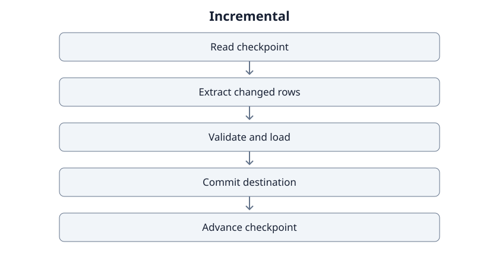

<a id="part-08"></a>

## Part 08 — Configuration and execution

### 38. Configuration-driven architecture

Illustrative advanced schema; v0.1 will use a smaller schema.

```yaml
version: 1
pipeline:
  name: customer_orders
  description: Consolidate customer and order records
connections:
  sales_db:
    type: postgresql
    host: ${POSTGRES_HOST}
    port: 5432
    database: sales
    username: ${POSTGRES_USER}
    password: ${POSTGRES_PASSWORD}
    sslmode: verify-full
sources:
  customers:
    connection: sales_db
    query: |
      SELECT customer_id, customer_name, country FROM customers
  orders:
    connection: sales_db
    query: |
      SELECT order_id, customer_id, amount FROM orders
transformations:
  - type: join
    left: orders
    right: customers
    on: [customer_id]
    how: left
    cardinality: many_to_one
    output: customer_orders
  - type: trim
    dataset: customer_orders
    columns: [customer_name, country]
validation:
  dataset: customer_orders
  rules:
    - type: not_null
      columns: [order_id, customer_id]
    - type: unique
      columns: [order_id]
    - type: range
      column: amount
      min: 0
destination:
  type: parquet
  dataset: customer_orders
  path: output/customer_orders.parquet
  mode: overwrite
execution:
  batch_size: 50000
  on_validation_failure: fail
```

### 39. Pipeline lifecycle

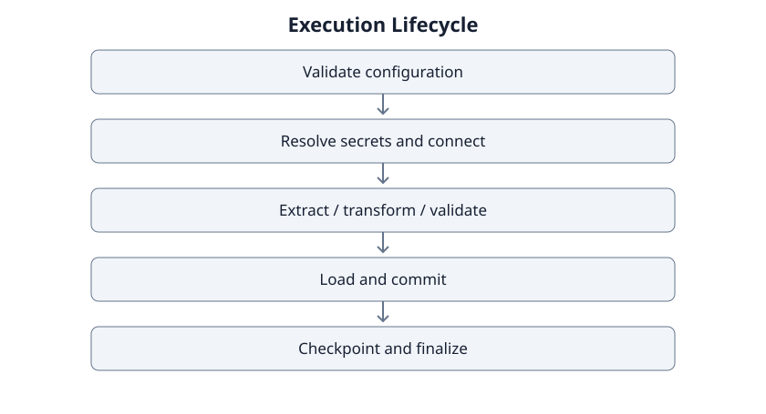

### 40. Execution status

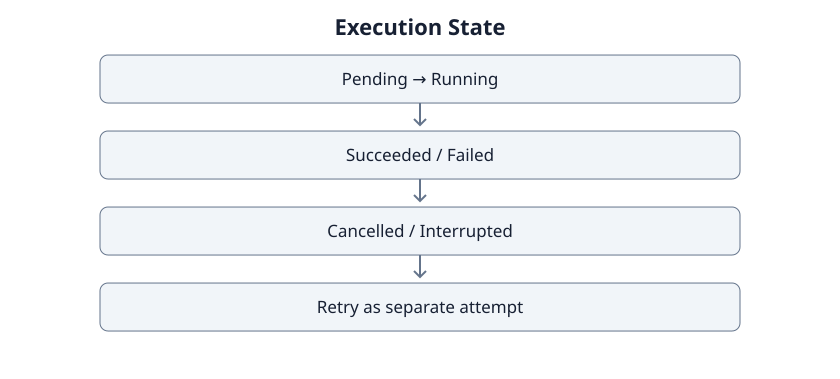

Retries are separate attempts; preserve failure history.

### 41. CLI commands

```bash
databridge --version
databridge --help
databridge init
databridge validate pipeline.yaml
databridge run pipeline.yaml
databridge run pipeline.yaml --dry-run
databridge connectors list
databridge connections test sales_db
databridge schema inspect sales_db
databridge runs list
databridge runs show RUN_ID
databridge logs RUN_ID
databridge schedules list
databridge dashboard
```

| Area | Specification |
| --- | --- |
| 0 | Success |
| 1 | General error |
| 2 | Invalid configuration or command |
| 3 | Connection failure |
| 4 | Extraction failure |
| 5 | Transformation failure |
| 6 | Validation failure |
| 7 | Destination failure |
| 130 | Interrupted |

### 42. Python SDK

```python
from databridge import Pipeline
pipeline = Pipeline.from_yaml("pipeline.yaml")
result = pipeline.run()
print(result.status)
print(result.rows_extracted)
print(result.rows_loaded)
print(result.duration_seconds)
```

Illustrative public API; keep it independent of internals.

<a id="part-09"></a>

## Part 09 — Metadata and storage

### 43. Metadata database

SQLite stores pipeline definitions, connection references, execution history, quality results, schedules and checkpoints, not every processed dataset.

### 44. Metadata ER model

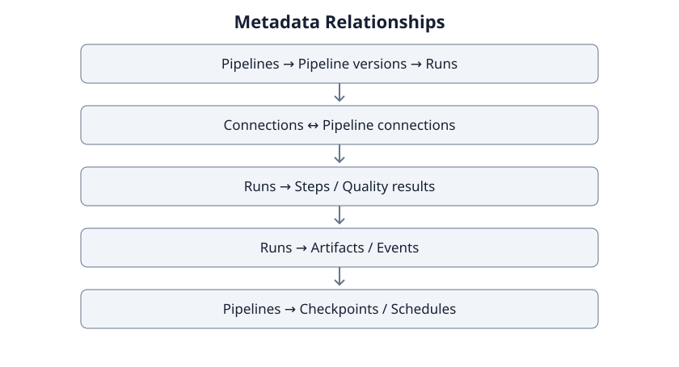

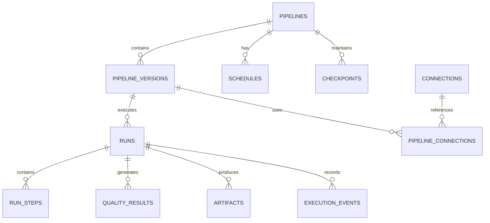

Relationships are one-to-many except the connection association, which links versions and connections.

| Area | Specification |
| --- | --- |
| PIPELINES | id PK, name, created_at, updated_at |
| PIPELINE_VERSIONS | id PK, pipeline_id FK, version, config_hash, configuration |
| CONNECTIONS | id PK, name, connector_type, settings, secret_reference |
| PIPELINE_CONNECTIONS | version_id FK, connection_id FK |
| RUNS | id PK, version_id FK, status, started_at, finished_at, rows_extracted, rows_loaded |
| RUN_STEPS | id PK, run_id FK, stage, status, duration_seconds |
| QUALITY_RESULTS | id PK, run_id FK, rule, status, failed_records |
| CHECKPOINTS | id PK, pipeline_id FK, source_key, cursor_value |
| ARTIFACTS | id PK, run_id FK, location, format, row_count |
| SCHEDULES | id PK, pipeline_id FK, expression, timezone, enabled |
| EXECUTION_EVENTS | id PK, run_id FK, level, message, created_at |

### 45. Runtime directories

```text
~/.config/databridge/
    settings.yaml, connections.yaml, pipelines/
~/.local/share/databridge/
    metadata.db, artifacts/
~/.local/state/databridge/
    logs/
~/.cache/databridge/
    temporary/
```

Separate runtime storage from source code. Proposed DATABRIDGE_HOME override for portable installations and containers. User-defined paths for external datasets.

<a id="part-10"></a>

## Part 10 — Security architecture

### 46. Security principles

Least privilege, secure defaults, explicit secrets, restricted logging, dependency security and fail-safe execution.

### 47. Credentials

Initial environment variables and development .env; optional OS keyring; advanced AWS Secrets Manager, Azure Key Vault and Google Secret Manager. Environment variables and .env are not encrypted vaults; enforce OS permissions.

```yaml
connection:
  type: postgresql
  host: ${POSTGRES_HOST}
  username: ${POSTGRES_USER}
  password: ${POSTGRES_PASSWORD}
```

### 48. Security requirements

| Area | Specification |
| --- | --- |
| Credential leakage | Secret references and redaction |
| SQL injection | Parameters and safe identifiers |
| Unauthorized access | Least privilege |
| Interception | TLS and certificate verification |
| Spreadsheet injection | Safe CSV/Excel export |
| Malicious YAML | Safe parsing and validation |
| Plugins | Trusted installation |
| Path traversal | Path validation and boundaries |
| Dependencies | Auditing and updates |
| Sensitive logs | Sanitization and retention |
| Partial output | Staged writes and atomic publication where supported |
| Console access | Localhost default and protected deployment |
| Resource exhaustion | Timeouts, batch limits, controls |
| Unsafe transforms | No arbitrary expression evaluation |
| Temporary files | Restricted permissions and cleanup |

User SQL is executable; parameters do not make arbitrary SQL safe. Use read-only source accounts unless writes are explicitly required.

### 49. Privacy

No central transmission of user data, credentials or metadata. Any future telemetry must be opt-in and documented. No raw records in logs; quarantine and intermediate persistence explicitly configured.

<a id="part-11"></a>

## Part 11 — Monitoring and scheduling

### 50. Logging

```json
{
  "timestamp": "2026-11-25T17:00:00Z",
  "level": "INFO",
  "pipeline": "customer_orders",
  "run_id": "example-run-001",
  "stage": "extraction",
  "event": "batch_completed",
  "rows": 50000,
  "duration_seconds": 2.41
}
```

### 51. Metrics

Total, successful and failed runs; total and stage durations (extract, transform, validate, load); extracted, loaded and rejected rows; quality failures; retry attempts; throughput.

### 52. Scheduling

Proposed APScheduler; cron and interval schedules, manual runs, time zones and missed-run policies. Requires an active process or persistent service. Prevent overlaps, lock executions and document recovery.

### 53. External orchestration

Airflow, Prefect, Dagster, cron and systemd can invoke CLI or SDK; no need for a distributed orchestration system.

<a id="part-12"></a>

## Part 12 — Graphical user interface

### 54. Dashboard technology

Native Streamlit components; no custom HTML, CSS, JavaScript, React or Node.js.

### 55. Dashboard modules

| Area | Specification |
| --- | --- |
| Overview | Pipeline and execution statistics |
| Connections | Configure and test |
| Data Explorer | Schemas and previews |
| SQL Workspace | Authorized queries |
| Pipelines | Create and manage |
| Executions | Start and monitor |
| Scheduler | Manage schedules |
| Data Quality | Validation reports |
| Logs | Sanitized logs |
| Artifacts | Generated outputs |
| Settings | Local settings |
| About | Version, license, docs |

### 56. Dashboard wireframe

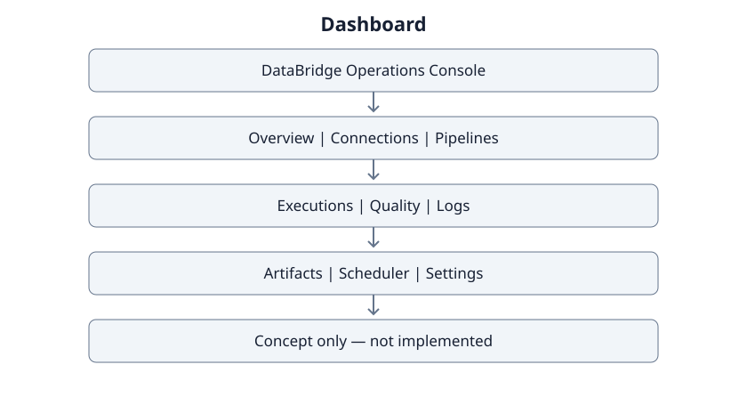

Concept only; illustrative metrics, neutral black and white theme, not an implemented application.

<a id="part-13"></a>

## Part 13 — Repository architecture

### 57. Target repository structure

```text
databridge/
  .github/
    workflows/ (ci.yml, release.yml, security.yml)
    ISSUE_TEMPLATE/, PULL_REQUEST_TEMPLATE.md, dependabot.yml
  src/databridge/
    __init__.py, __main__.py, cli.py, config.py, exceptions.py, py.typed
    connectors/
      __init__.py, base.py, registry.py
      databases/ (sqlite.py, postgresql.py, mysql.py, clickhouse.py)
      warehouses/ (snowflake.py, bigquery.py, redshift.py)
      files/ (csv.py, excel.py, json.py, parquet.py)
      storage/ (s3.py, azure_blob.py, gcs.py)
      api/ (rest.py)
    engine/
      pipeline.py, executor.py, extractor.py, transformer.py
      validator.py, loader.py, checkpoint.py, scheduler.py
    transformations/
      base.py, registry.py, filter.py, rename.py, cast.py
      join.py, aggregate.py
    quality/ (rules.py, uniqueness.py, completeness.py, schema.py,
              integrity.py)
    destinations/ (base.py, registry.py, csv.py, excel.py, json.py,
                   parquet.py, database.py, object_storage.py)
    metadata/ (models.py, repository.py, database.py, migrations/)
    security/ (secrets.py, masking.py)
    monitoring/ (logger.py, metrics.py, events.py)
    dashboard/ (app.py, pages/, components/)
  tests/ (unit/, integration/, end_to_end/, fixtures/)
  examples/ (pipelines/, queries/, datasets/)
  docs/ (architecture/, getting-started/, connectors/, transformations/,
         destinations/, development/)
  .env.example, .gitignore, .dockerignore, .python-version
  .pre-commit-config.yaml, Dockerfile, compose.yaml
  pyproject.toml, uv.lock, mkdocs.yml, README.md, LICENSE
  CHANGELOG.md, CONTRIBUTING.md, CODE_OF_CONDUCT.md, SECURITY.md
```

Python package subdirectories include __init__.py where required. Add connector files as implemented.

### 58. Documentation and ADRs

```text
docs/architecture/overview.md, system-design.md, data-engine.md,
                  security.md, decisions/
docs/getting-started/installation.md, quickstart.md, first-pipeline.md
docs/development/setup.md, testing.md, contributing.md, release-process.md
docs/connectors/, transformations/, destinations/
```

| Area | Specification |
| --- | --- |
| ADR-001 | Python |
| ADR-002 | Modular monolith |
| ADR-003 | Arrow interchange |
| ADR-004 | Polars |
| ADR-005 | YAML |
| ADR-006 | Plugin architecture |
| ADR-007 | SQLite metadata |
| ADR-008 | Native Streamlit |

| Area | Specification |
| --- | --- |
| ADR-009 | uv |
| ADR-010 | Secure defaults |

<a id="part-14"></a>

## Part 14 — Software development lifecycle

### 59. Git strategy

GitHub Flow: stable main, short-lived feat/configuration-engine, feat/sqlite-connector, feat/csv-destination, fix/connection-cleanup and docs/installation-guide branches. Pull requests and automated checks; no permanent develop branch.

### 60. Commits

Conventional Commits: feat, fix, docs, test, refactor, perf, build, ci, chore and project-specific security. Example: feat: implement SQLite source connector; test: cover connector resource cleanup; fix: prevent incomplete CSV publication.

### 61. Development standards

PEP 8, typed public interfaces, Ruff format/lint, strict mypy, centralized exceptions, docstrings, Pydantic validation, tests, no hardcoded secrets, pathlib, explicit connection cleanup, pyproject.toml and uv.lock, documented versioned APIs and compatibility matrix.

### 62. Testing strategy


Also regression, security, performance, OS/Python compatibility and recovery. Test empty datasets, nulls, duplicate/conflicting keys, schema mismatch, connection/credential failures, destination failures, interruption, large datasets and conversion errors.

### 63. CI quality gates

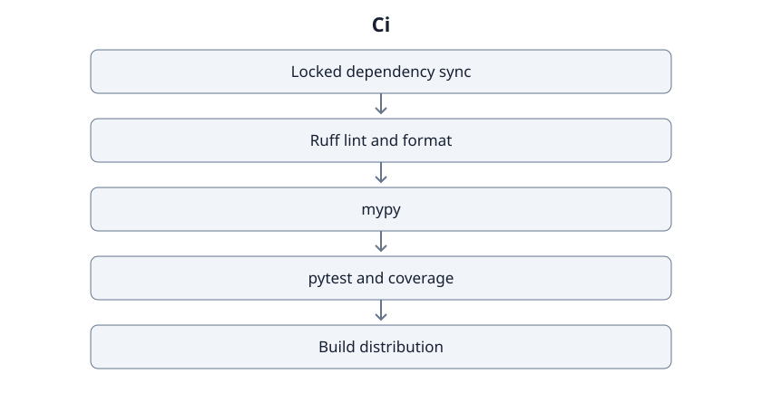

```bash
uv sync --locked
uv run ruff check .
uv run ruff format --check .
uv run mypy
uv run pytest --cov=databridge
uv build
```

### 64. Releases

Semantic versioning: major breaking changes, minor compatible features, patch compatible fixes. v0.x interfaces may change; document breaks. Update version and changelog, test, build, tag, release and publish to approved registries.

<a id="part-15"></a>

## Part 15 — Deployment and distribution

### 65. Installation

```bash
pip install databridge
uv tool install databridge
git clone <official-repository-url>
cd databridge
uv sync
docker compose up -d
```

Intended commands only; name, repository and container not verified or published.

### 66. Deployment models

Local workstation, self-hosted Linux/Windows server, reproducible Docker container or external orchestration via CLI/SDK.

### 67. Optional dependencies

```bash
pip install "databridge[postgresql]"
pip install "databridge[mysql]"
pip install "databridge[clickhouse]"
pip install "databridge[excel]"
pip install "databridge[s3]"
pip install "databridge[dashboard]"
```

Install only needed drivers and SDKs to reduce conflicts, size and exposure.

### 68. System requirements

| Resource | Minimum | Recommended |
| --- | --- | --- |
| CPU | 2 cores | 4–8 cores |
| RAM | 4 GB | 8–16 GB |
| Disk | 2 GB plus data | SSD, workload-specific |
| Python | 3.12 | Supported 3.12 release |
| OS | Linux, Windows, macOS | Linux for persistent service |
| Network | Source-dependent | Reliable |

Proposed development requirements; actual needs depend on data, operations and concurrency.

<a id="part-16"></a>

## Part 16 — Open-source governance

### 69. Licensing

Proposed Apache 2.0: permissive use, modification and redistribution including commercial use, subject to conditions and patent provisions. Confirm license and dependency compatibility before publishing.

### 70. Governance

GitHub Issues for bugs/features; Discussions for community; pull requests for contributions; ADRs for design; responsible security disclosure; GitHub Releases; MkDocs; Code of Conduct.

### 71. IP boundaries

Independent development only. Do not copy employer-owned code, data, internal queries, credentials, configuration or confidential documentation. Use synthetic or licensed public datasets. Verify name, package identifier, trademark and ownership before release.

<a id="part-17"></a>

## Part 17 — Development roadmap

### 72. Release milestones

| Area | Specification |
| --- | --- |
| v0.1.0 | Core: package, YAML, CLI, SQLite/PostgreSQL/MySQL/ClickHouse, batch extraction, CSV/Excel, basic validation and tests |
| v0.2.0 | Polars, file sources, multiple datasets, joins, cleaning, schema and uniqueness, reports, SDK |
| v0.3.0 | Parquet/JSON, DuckDB, incremental, discovery, checkpoints, initial database destinations |
| v0.4.0 | Streamlit console, connections, explorer, pipelines, history, metadata, quality visualization |
| v0.5.0 | Additional databases/warehouses, REST, S3/Azure/GCS and writes |
| v0.6.0 | Scheduling, retries, locking, cancellation, recovery, dependencies, monitoring |
| v0.7.0 | Public connector and transformation plugins, custom rules, contributor tooling |
| v0.8.0 | Benchmarks, memory optimization, schema drift, security and resource controls |
| v0.9.0 | Compatibility, docs, API stabilization, bugs and migrations |
| v1.0.0 | Stable tested documented self-hosted release |

### 73. Indicative timeline

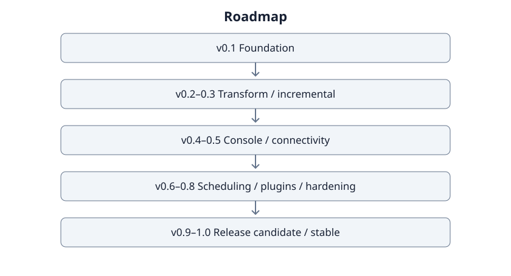

Illustrative 12-month part-time plan, not a commitment. Phases overlap; full connector reliability may take considerably longer.

<a id="part-18"></a>

## Part 18 — Initial implementation plan

### 74. Current status

Verified from terminal: Fedora/Zsh, Git main, Python 3.12.16, uv, 38 directories and 22 files, core dependency imports, package import, Ruff/Pytest/mypy availability. Final pyproject verification, engine, connectors, tests and public release pending.

### 75. v0.1 implementation checklist
- [ ] 01. Finalize pyproject.toml
- [ ] 02. Configure .gitignore
- [ ] 03. Create .env.example
- [ ] 04. Initialize package metadata
- [ ] 05. Exception hierarchy
- [ ] 06. Configuration models
- [ ] 07. YAML loader
- [ ] 08. Secret resolution
- [ ] 09. Structured logging
- [ ] 10. Arrow batch contracts
- [ ] 11. Source connector interface
- [ ] 12. Connector registry
- [ ] 13. SQLite connector
- [ ] 14. Extraction engine
- [ ] 15. Destination interface
- [ ] 16. Destination registry
- [ ] 17. CSV destination
- [ ] 18. Basic schema validation
- [ ] 19. Pipeline orchestrator
- [ ] 20. CLI
- [ ] 21. First end-to-end pipeline
- [ ] 22. PostgreSQL connector
- [ ] 23. MySQL connector
- [ ] 24. ClickHouse connector
- [ ] 25. Excel destination
- [ ] 26. Integration tests
- [ ] 27. GitHub Actions
- [ ] 28. README and docs
- [ ] 29. Build packages
- [ ] 30. Release v0.1.0

### 76. First working milestone

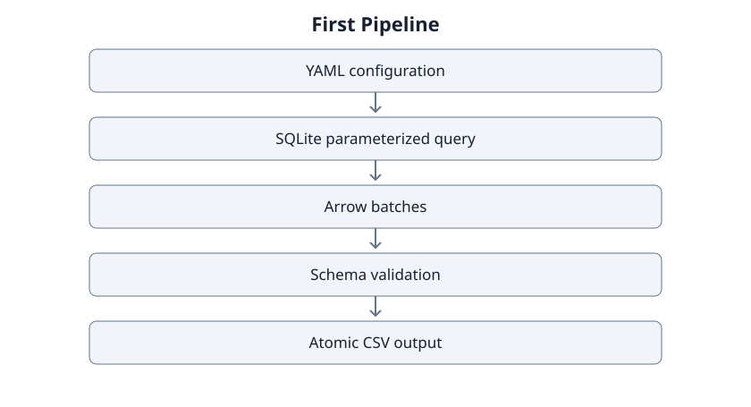

| Area | Specification |
| --- | --- |
| Valid YAML | Accepted |
| Invalid YAML | Actionable rejection |
| Missing DB | Safe failure |
| Valid query | Extract records |
| Parameterized query | Safe parameter handling |
| Empty data | Correct handling |
| Schema mismatch | Explicit failure |
| CSV | Published successfully |
| Write failure | No incomplete final file |
| Connections | Resources released |
| Logs | Status and metrics |
| CLI | Correct exit status |
| Tests | Required tests pass |

<a id="part-19"></a>

## Part 19 — Risks and project boundaries

### 77. Risks

| Area | Specification |
| --- | --- |
| Excessive scope (high) | Incremental milestones |
| Type incompatibility (high) | Explicit mapping and tests |
| Memory exhaustion (high) | Batch and disk-backed processing |
| Silent corruption (critical) | Integrity validation |
| Credential exposure (critical) | Secure resolution |
| Duplicate writes (high) | Checkpoints and idempotency |
| Connector maintenance (high) | Contracts and integration tests |
| Dependency conflicts (medium) | Optional extras and locks |
| Config changes (medium) | Schema versioning |
| Scheduler overlap (high) | Locking |
| Untrusted plugins (high) | Trusted installation and docs |
| Insufficient testing (high) | CI gates |
| Name/license conflict (high) | Verify before publishing |
| Limited capacity (high) | Prioritize and onboard contributors |

### 78. Excluded initially

Spark, Kafka, Kubernetes, microservices, custom database or Rust/C++ engine, React/Angular, distributed worker clusters, full CDC, machine learning platform, BI visualization platform and commercial managed services. Existing engines and native Streamlit meet initial needs.

### 79. Definition of done

Typed, documented, tested and reviewed against requirements; supported environments; no known critical security or integrity defects. Release requires passing tests, successful builds, verified installation, updated docs and explicit limitations.

<a id="part-20"></a>

## Part 20 — Final project specification

### 80. Architecture summary

| Area | Specification |
| --- | --- |
| Language | Python 3.12 |
| Architecture | Modular monolith, plugin interfaces |
| Processing | Batch-first ETL / selected ELT |
| Engine | Polars, Arrow, DuckDB |
| Database | SQLAlchemy + native drivers |
| Configuration | YAML + Pydantic |
| Interfaces | Typer CLI, Streamlit console, Python SDK |
| Metadata | SQLite |
| Scheduling | APScheduler proposed |
| Packaging | uv, uv_build |
| Quality | Pytest, Ruff, mypy |
| CI/CD | GitHub Actions |
| Deployment | Python package and Docker |
| Docs | MkDocs Material |
| License | Apache 2.0 proposed |
| Releases | v0.1.0 to v1.0.0 |

### 81. Final workflow

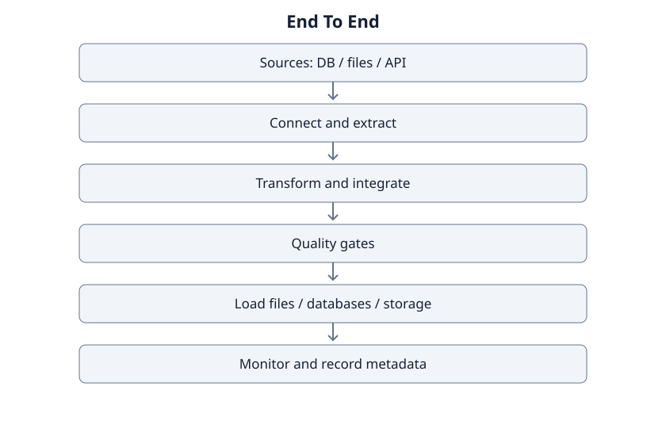

### 82. Official project description

DataBridge is an open-source, cloud-agnostic data integration and engineering platform designed to simplify movement, transformation, validation and delivery across heterogeneous systems. Built with Python and optimized columnar technologies, it provides a modular configuration-driven architecture for reliable reusable pipelines. It aims to support databases, warehouses, APIs, files and object storage through standardized connectors. It combines extraction, transformation, quality, destination management, monitoring and automation in a unified self-hosted environment. It is designed for engineers, analysts, developers and organizations seeking lightweight, transparent, vendor-independent operations. Local or self-managed deployment with CLI, SDK and graphical console. Mission: make reliable data engineering accessible, extensible and independent of proprietary infrastructure.

### 83. Decisions and outstanding items

Proposed decisions without separate approval: Apache 2.0, Arrow contract, entry-point plugins, APScheduler, XDG paths, metadata schema, GitHub Flow, performance targets and release sequence. Brand/PyPI and IP separation unverified; license approval pending; benchmarks and connector tests not performed; configuration and metadata schemas proposed; dashboard not started; security review not performed; timeline estimated; final package configuration awaiting verification. Preserve as docs/architecture/master-plan.md and maintain separate SRS, architecture, security, roadmap and ADR documents.

This Markdown edition is based on the condensed PDF. SVG figures preserve its static diagrams; the batch estimator is a worked example and the checklist uses Markdown task boxes.