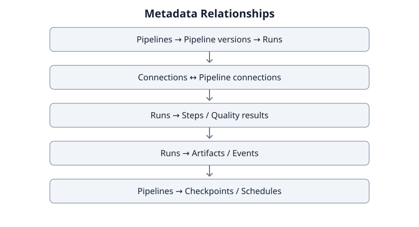
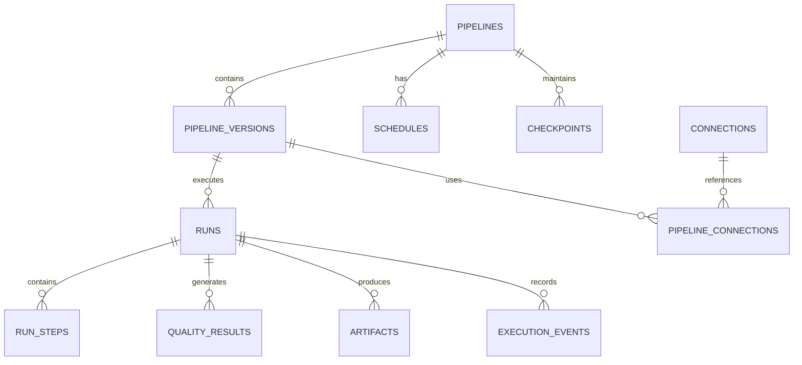

# Metadata and storage

[Documentation home](../README.md) · [Complete master plan](../architecture/master-plan.md)

> Design specification — proposed capabilities unless explicitly marked verified.

### 43. Metadata database

SQLite stores pipeline definitions, connection references, execution history, quality results, schedules and checkpoints, not every processed dataset.

### 44. Metadata ER model





Relationships are one-to-many except the connection association, which links versions and connections.

| Area | Specification |
| --- | --- |
| PIPELINES | id PK, name, created_at, updated_at |
| PIPELINE_VERSIONS | id PK, pipeline_id FK, version, config_hash, configuration |
| CONNECTIONS | id PK, name, connector_type, settings, secret_reference |
| PIPELINE_CONNECTIONS | version_id FK, connection_id FK |
| RUNS | id PK, version_id FK, status, started_at, finished_at, rows_extracted, rows_loaded |
| RUN_STEPS | id PK, run_id FK, stage, status, duration_seconds |
| QUALITY_RESULTS | id PK, run_id FK, rule, status, failed_records |
| CHECKPOINTS | id PK, pipeline_id FK, source_key, cursor_value |
| ARTIFACTS | id PK, run_id FK, location, format, row_count |
| SCHEDULES | id PK, pipeline_id FK, expression, timezone, enabled |
| EXECUTION_EVENTS | id PK, run_id FK, level, message, created_at |

### 45. Runtime directories

```text
~/.config/databridge/
    settings.yaml, connections.yaml, pipelines/
~/.local/share/databridge/
    metadata.db, artifacts/
~/.local/state/databridge/
    logs/
~/.cache/databridge/
    temporary/
```

Separate runtime storage from source code. Proposed DATABRIDGE_HOME override for portable installations and containers. User-defined paths for external datasets.
