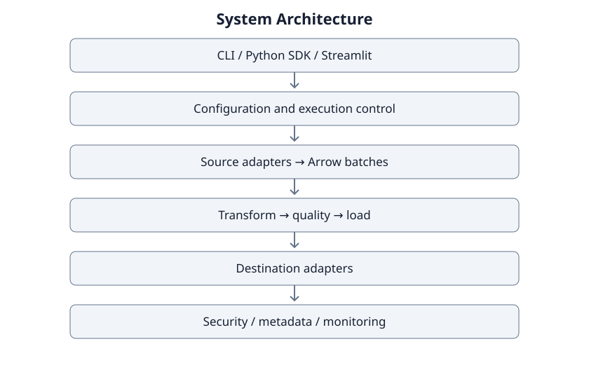
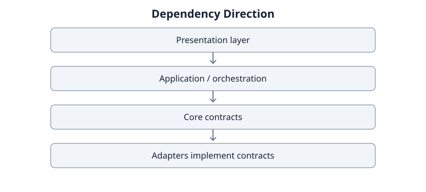

# System architecture

[Documentation home](../README.md) · [Complete master plan](../architecture/master-plan.md)

> Design specification — proposed capabilities unless explicitly marked verified.

### 14. Architecture

Modular monolith with plugin-oriented interfaces and layered responsibilities. Single Python package initially, avoiding microservices complexity.

### 15. Patterns

Adapter for connectivity; strategy for transformations and rules; registry for discovery; factory for initialization; repository for metadata; dependency injection; pipeline; context managers; future producer-consumer batching. Use only when practical.

### 16. Control and data planes

Control: configurations, connections, schedules, history, settings and metadata. Data: connectivity, extraction, transformations, validation, loading and batches. Engine runs independently of UI or scheduler.

### 17. Components

Configuration manager parses and validates; connection manager initializes settings; registries resolve adapters; pipeline manager coordinates stages; execution manager tracks lifecycle; extraction, transformation, quality and loading engines process data; scheduler triggers runs; checkpoints track state; metadata repository persists operations; secrets resolve credentials; monitoring records events; dashboard, CLI and SDK expose interfaces.

### 18. Dependency rules

Core must not import Typer or Streamlit. Interfaces separate engine from native drivers and processing implementations.

