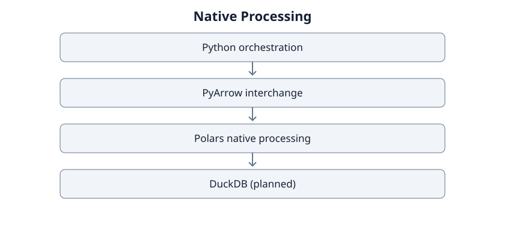

# Technology stack

[Documentation home](../README.md) · [Complete master plan](../architecture/master-plan.md)

> Design specification — proposed capabilities unless explicitly marked verified.

### 19. Languages

Python 3.12 primary; SQL queries and transforms; YAML, TOML and JSON configuration/data; shell automation. No custom Rust, C++, Go, Java or JavaScript initially.

### 20. Frameworks

Pydantic typed validation; Typer CLI; Streamlit native console; SQLAlchemy relational abstraction.

### 21. Processing technologies

Polars primary transformations and lazy/streaming operations; PyArrow columnar interchange and Parquet; DuckDB embedded SQL analytics; Pandas optional compatibility.

### 22. Native engines

Python orchestrates optimized native libraries; actual performance depends on workload and memory.

### 23. Technology inventory

| Area | Specification |
| --- | --- |
| Configuration | YAML, Pydantic, PyYAML |
| Interfaces | Typer, Streamlit |
| Processing | Polars, PyArrow, DuckDB, optional Pandas |
| Database | SQLAlchemy, SQLite metadata |
| Files / HTTP | OpenPyXL, HTTPX |
| Secrets | python-dotenv, optional OS keyring |
| Scheduling / retries | APScheduler, Tenacity (proposed) |
| Standard library | logging, importlib.metadata, pathlib, uuid |
| Packaging | uv, uv_build, uv.lock |
| Testing | Pytest, pytest-cov, Testcontainers |
| Quality | Ruff, mypy, pre-commit |

| Area | Specification |
| --- | --- |
| Documentation | MkDocs Material |
| Version control / CI | Git, GitHub, GitHub Actions |
| Deployment | Docker, Compose, PyPI, GHCR |
| Security | Dependabot, CodeQL, pip-audit |
| License | Apache 2.0 proposed |
