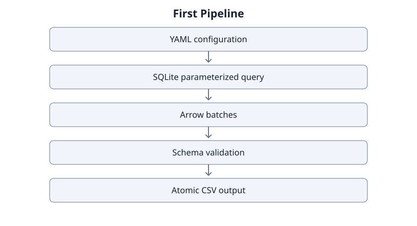

# Initial implementation plan

[Documentation home](../README.md) · [Complete master plan](../architecture/master-plan.md)

> Design specification — proposed capabilities unless explicitly marked verified.

### 74. Current status

Verified from terminal: Fedora/Zsh, Git main, Python 3.12.16, uv, 38 directories and 22 files, core dependency imports, package import, Ruff/Pytest/mypy availability. Final pyproject verification, engine, connectors, tests and public release pending.

### 75. v0.1 implementation checklist
- [ ] 01. Finalize pyproject.toml
- [ ] 02. Configure .gitignore
- [ ] 03. Create .env.example
- [ ] 04. Initialize package metadata
- [ ] 05. Exception hierarchy
- [ ] 06. Configuration models
- [ ] 07. YAML loader
- [ ] 08. Secret resolution
- [ ] 09. Structured logging
- [ ] 10. Arrow batch contracts
- [ ] 11. Source connector interface
- [ ] 12. Connector registry
- [ ] 13. SQLite connector
- [ ] 14. Extraction engine
- [ ] 15. Destination interface
- [ ] 16. Destination registry
- [ ] 17. CSV destination
- [ ] 18. Basic schema validation
- [ ] 19. Pipeline orchestrator
- [ ] 20. CLI
- [ ] 21. First end-to-end pipeline
- [ ] 22. PostgreSQL connector
- [ ] 23. MySQL connector
- [ ] 24. ClickHouse connector
- [ ] 25. Excel destination
- [ ] 26. Integration tests
- [ ] 27. GitHub Actions
- [ ] 28. README and docs
- [ ] 29. Build packages
- [ ] 30. Release v0.1.0

### 76. First working milestone

| Area | Specification |
| --- | --- |
| Valid YAML | Accepted |
| Invalid YAML | Actionable rejection |
| Missing DB | Safe failure |
| Valid query | Extract records |
| Parameterized query | Safe parameter handling |
| Empty data | Correct handling |
| Schema mismatch | Explicit failure |
| CSV | Published successfully |
| Write failure | No incomplete final file |
| Connections | Resources released |
| Logs | Status and metrics |
| CLI | Correct exit status |
| Tests | Required tests pass |
