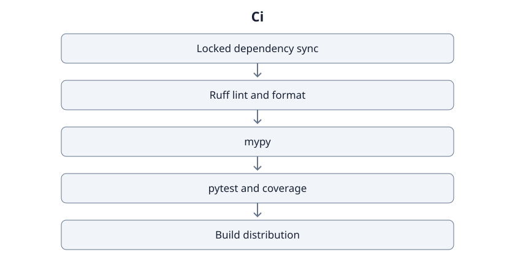

# Software development lifecycle

[Documentation home](../README.md) · [Complete master plan](../architecture/master-plan.md)

> Design specification — proposed capabilities unless explicitly marked verified.

### 59. Git strategy

GitHub Flow: stable main, short-lived feat/configuration-engine, feat/sqlite-connector, feat/csv-destination, fix/connection-cleanup and docs/installation-guide branches. Pull requests and automated checks; no permanent develop branch.

### 60. Commits

Conventional Commits: feat, fix, docs, test, refactor, perf, build, ci, chore and project-specific security. Example: feat: implement SQLite source connector; test: cover connector resource cleanup; fix: prevent incomplete CSV publication.

### 61. Development standards

PEP 8, typed public interfaces, Ruff format/lint, strict mypy, centralized exceptions, docstrings, Pydantic validation, tests, no hardcoded secrets, pathlib, explicit connection cleanup, pyproject.toml and uv.lock, documented versioned APIs and compatibility matrix.

### 62. Testing strategy


Also regression, security, performance, OS/Python compatibility and recovery. Test empty datasets, nulls, duplicate/conflicting keys, schema mismatch, connection/credential failures, destination failures, interruption, large datasets and conversion errors.

### 63. CI quality gates



```bash
uv sync --locked
uv run ruff check .
uv run ruff format --check .
uv run mypy
uv run pytest --cov=databridge
uv build
```

### 64. Releases

Semantic versioning: major breaking changes, minor compatible features, patch compatible fixes. v0.x interfaces may change; document breaks. Update version and changelog, test, build, tag, release and publish to approved registries.
