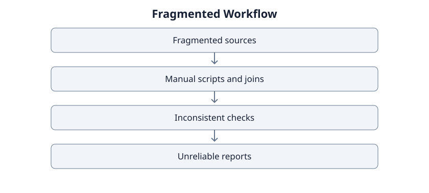

# Problem statement

[Documentation home](../README.md) · [Complete master plan](../architecture/master-plan.md)

> Design specification — proposed capabilities unless explicitly marked verified.

### 6. Problems and solutions

Fragmented systems lead to repeated scripts, manual joins, copy-paste, inconsistent validation, data errors, lost time and maintenance overhead.

| Area | Specification |
| --- | --- |
| Scattered data | Unified connectors |
| Repeated scripts | Reusable pipelines |
| Manual files | Automated ingestion and export |
| Different protocols | Standard interfaces |
| Duplicates and conflicts | Explicit quality rules |
| Missing data | Schema and completeness validation |
| Cross-database joins | Transformation engine |
| Hardcoded credentials | Secret resolution |
| Untraceable failures | Logs and history |
| Full extraction | Incremental checkpoints |
| Memory limits | Batch processing |
| Vendor lock-in | Portable open formats |
| Complex deployment | Local and containerized deployment |
| Central management | Self-hosted console |
| Maintenance | Modular tested documentation |

### 7. Use cases

MySQL to PostgreSQL migration; ClickHouse to Parquet; Excel + PostgreSQL enrichment; REST API to PostgreSQL; multi-source consolidation; scheduled SQL-to-CSV reporting; quality audits; warehouse ingestion to Snowflake; Parquet to S3; reconciliation; incremental PostgreSQL to ClickHouse; clean analytical datasets. Large transfers depend on connector and batching semantics.

### 8. Target users

Data engineers, analysts, MIS professionals, developers, BI developers, DBAs, researchers, small teams and open-source contributors.

### 9. Positioning

Airflow orchestrates; Airbyte replicates and integrates; dbt transforms in SQL; Spark distributes processing; Kafka streams events; DuckDB, Polars and Pandas are complementary or internal engines. DataBridge aims to combine lightweight integration, quality enforcement and business-ready delivery, not claim competitors lack these features.
