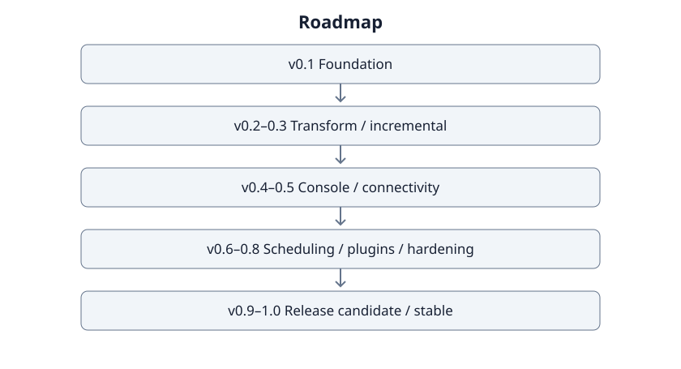

# Development roadmap

[Documentation home](../README.md) · [Complete master plan](../architecture/master-plan.md)

> Design specification — proposed capabilities unless explicitly marked verified.

### 72. Release milestones

| Area | Specification |
| --- | --- |
| v0.1.0 | Core: package, YAML, CLI, SQLite/PostgreSQL/MySQL/ClickHouse, batch extraction, CSV/Excel, basic validation and tests |
| v0.2.0 | Polars, file sources, multiple datasets, joins, cleaning, schema and uniqueness, reports, SDK |
| v0.3.0 | Parquet/JSON, DuckDB, incremental, discovery, checkpoints, initial database destinations |
| v0.4.0 | Streamlit console, connections, explorer, pipelines, history, metadata, quality visualization |
| v0.5.0 | Additional databases/warehouses, REST, S3/Azure/GCS and writes |
| v0.6.0 | Scheduling, retries, locking, cancellation, recovery, dependencies, monitoring |
| v0.7.0 | Public connector and transformation plugins, custom rules, contributor tooling |
| v0.8.0 | Benchmarks, memory optimization, schema drift, security and resource controls |
| v0.9.0 | Compatibility, docs, API stabilization, bugs and migrations |
| v1.0.0 | Stable tested documented self-hosted release |

### 73. Indicative timeline

Illustrative 12-month part-time plan, not a commitment. Phases overlap; full connector reliability may take considerably longer.
