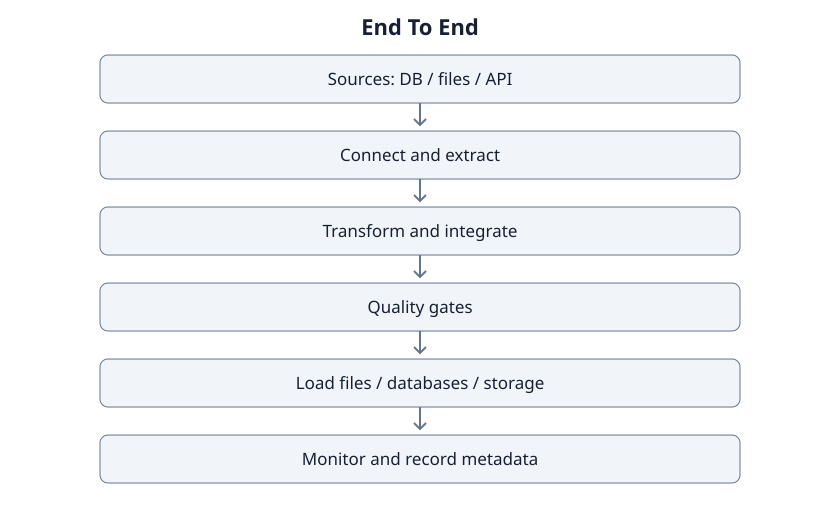

# Final project specification

[Documentation home](../README.md) · [Complete master plan](../architecture/master-plan.md)

> Design specification — proposed capabilities unless explicitly marked verified.

### 80. Architecture summary

| Area | Specification |
| --- | --- |
| Language | Python 3.12 |
| Architecture | Modular monolith, plugin interfaces |
| Processing | Batch-first ETL / selected ELT |
| Engine | Polars, Arrow, DuckDB |
| Database | SQLAlchemy + native drivers |
| Configuration | YAML + Pydantic |
| Interfaces | Typer CLI, Streamlit console, Python SDK |
| Metadata | SQLite |
| Scheduling | APScheduler proposed |
| Packaging | uv, uv_build |
| Quality | Pytest, Ruff, mypy |
| CI/CD | GitHub Actions |
| Deployment | Python package and Docker |
| Docs | MkDocs Material |
| License | Apache 2.0 proposed |
| Releases | v0.1.0 to v1.0.0 |

### 81. Final workflow

### 82. Official project description

DataBridge is an open-source, cloud-agnostic data integration and engineering platform designed to simplify movement, transformation, validation and delivery across heterogeneous systems. Built with Python and optimized columnar technologies, it provides a modular configuration-driven architecture for reliable reusable pipelines. It aims to support databases, warehouses, APIs, files and object storage through standardized connectors. It combines extraction, transformation, quality, destination management, monitoring and automation in a unified self-hosted environment. It is designed for engineers, analysts, developers and organizations seeking lightweight, transparent, vendor-independent operations. Local or self-managed deployment with CLI, SDK and graphical console. Mission: make reliable data engineering accessible, extensible and independent of proprietary infrastructure.

### 83. Decisions and outstanding items

Proposed decisions without separate approval: Apache 2.0, Arrow contract, entry-point plugins, APScheduler, XDG paths, metadata schema, GitHub Flow, performance targets and release sequence. Brand/PyPI and IP separation unverified; license approval pending; benchmarks and connector tests not performed; configuration and metadata schemas proposed; dashboard not started; security review not performed; timeline estimated; final package configuration awaiting verification. Preserve as docs/architecture/master-plan.md and maintain separate SRS, architecture, security, roadmap and ADR documents.

This Markdown edition is based on the condensed PDF. SVG figures preserve its static diagrams; the batch estimator is a worked example and the checklist uses Markdown task boxes.
